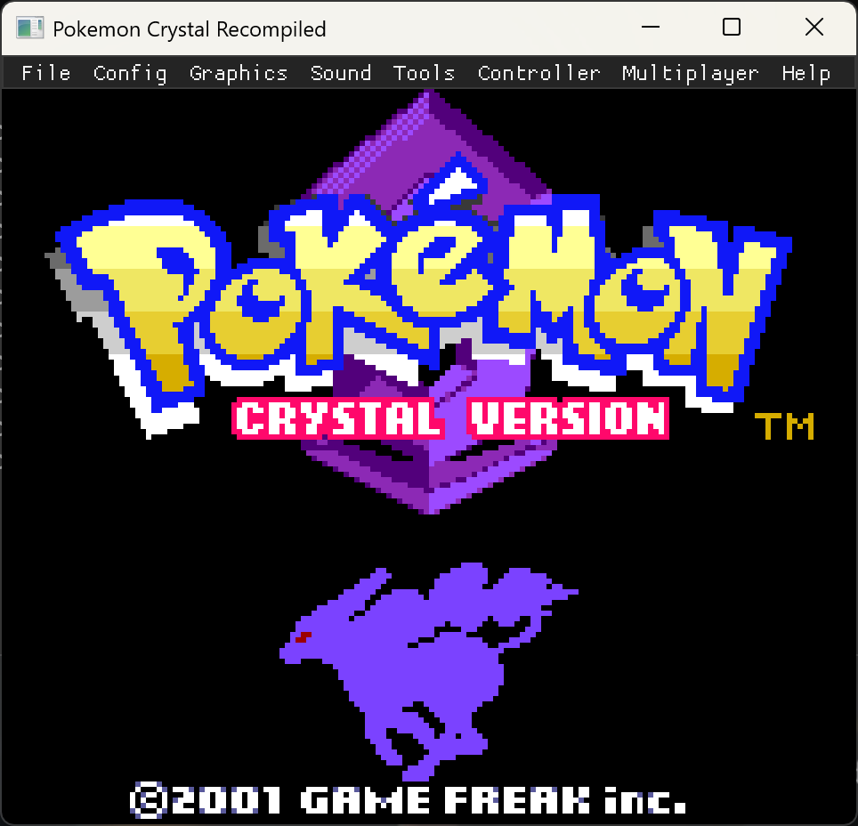
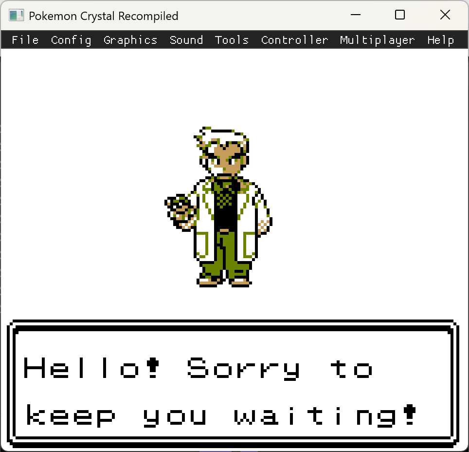
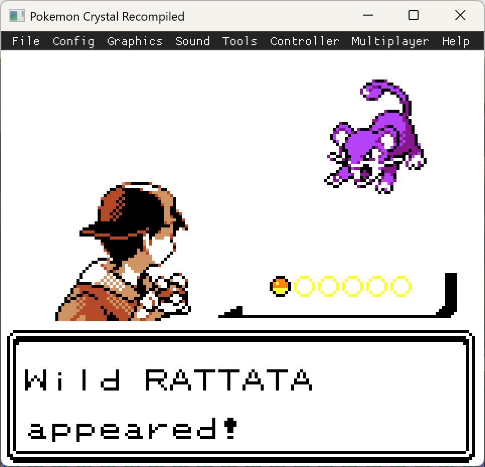
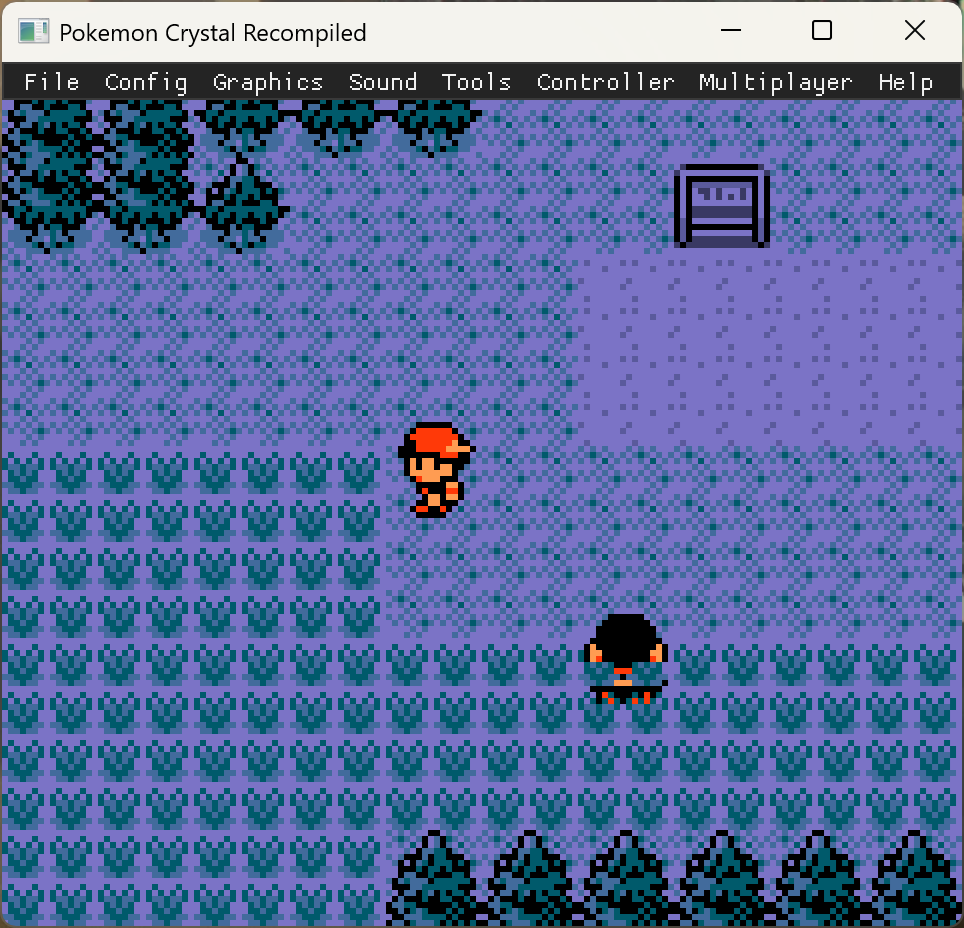

# Pokémon Crystal — Statically Recompiled

> *Pokémon Crystal as a native executable. No emulator, no ROM interpretation at runtime — just Color machine code translated ahead of time into portable C.*

This repository ports **Pokémon Crystal Version (Game Boy Color, 2000/2001)** to native code via [**gb-recompiled**](https://github.com/sp00nznet/gb-recompiled). It's the second Generation II title attempted with this toolchain (after [pokemon-gold](https://github.com/sp00nznet/pokemon-gold)); same MBC3+TIMER+RAM+BATTERY mapper, same recipe.

Why a separate repo from Gold? Crystal carries a different ROM and a different generated `rom.c` (~85 MB vs Gold's ~58 MB — Crystal has noticeably more code, courtesy of the Suicune story arc, the female protagonist sprite set, expanded Unown handling, and mobile-adapter scaffolding). The shared infrastructure lives entirely in the `gbrecomp/` submodule.

|  |  |
|---|---|
|  |  |
| Suicune silhouette, ©2001 GAME FREAK. Window title obeys the new `GBRT_WINDOW_TITLE` macro. | "Hello! Sorry to keep you waiting." — Elm, same line as Gold. |
|  |  |
| Wild Rattata. Crystal's encounter table differs from Gold's Hoothoot. | Overworld; CGB palettes, sprites, NPC, scrolling all behaving. |

---

## ✅ Status: First boot complete

| Milestone | Status |
| --- | :---: |
| Repo scaffolding (CMake, submodule, entry point) | ✅ |
| Cart identified: `PM_CRYSTAL`, MBC3+TIMER+RAM+BATTERY (cart type 0x10) | ✅ |
| Recompile (`gbrecomp` → 85 MB `rom.c` + 13 MB `rom_rom.c`) | ✅ |
| `rom.exe` builds under MSVC + vcpkg SDL2 (18.2 MB binary) | ✅ |
| First boot to title screen (visually confirmed) | ✅ |
| Intro dialogue + wild encounter render | ✅ |
| Overworld walks and scrolls | ✅ |
| RTC persistence (same `.rtc` sidecar as Gold) | ✅ |
| Trace-guided recompile pass | ⏳ |
| Day/night cycle visually confirmed | ⏳ user-test |
| Save round-trip a full party + box | ⏳ user-test |
| Add Crystal row to `gb-recompiled/COMPATIBILITY.md` | ⏳ |

---

## Building

Same toolchain as [pokemon-gold](https://github.com/sp00nznet/pokemon-gold) — see that README for the full prerequisite list. Quick path:

```bash
git clone --recurse-submodules https://github.com/sp00nznet/pokemon-crystal.git
cd pokemon-crystal
# Place your legally obtained Pokemon Crystal ROM at roms/rom.gbc

# Build the toolchain (Windows MSVC + vcpkg shown; MinGW also works):
cmd /c '"<vcvars64.bat>" && cd gbrecomp && cmake -G Ninja -B build \
    -DCMAKE_TOOLCHAIN_FILE=C:/vcpkg/scripts/buildsystems/vcpkg.cmake \
    -DVCPKG_TARGET_TRIPLET=x64-windows && cmake --build build'

# Recompile your ROM:
./gbrecomp/build/bin/gbrecomp roms/rom.gbc -o .

# Build the game:
cmake -G Ninja -B build -DCMAKE_TOOLCHAIN_FILE=C:/vcpkg/scripts/buildsystems/vcpkg.cmake -DVCPKG_TARGET_TRIPLET=x64-windows
cmake --build build
./build/rom
```

Save data lives next to `rom.exe`: `PM_CRYSTAL.sav` (cart RAM) and `PM_CRYSTAL.rtc` (48-byte BGB-compatible RTC sidecar). The runtime advances the RTC by the wall-clock interval since the last save, so the day/night clock keeps ticking while the system is off.

---

## Why this works

The hard runtime parts — MBC3 mapper, RTC registers, `.rtc` save persistence, CGB palettes, audio, ImGui debug overlay, gamepad — all live in `sp00nznet/gb-recompiled` and are shared with pokemon-gold. Crystal needed nothing new beyond a private repo, the scaffolding files (`CMakeLists.txt`, `rom.h`, `rom_main.c`), and pointing `gbrecomp` at the same fork commit.

---

## Legal

This repository contains **zero** copyrighted Nintendo material. The generated `rom.c` / `rom_rom.c` files are derivatives of *your* ROM dump, never committed, never distributed. Repository code is MIT; the game is and remains the property of Nintendo / Game Freak / The Pokémon Company.

> *Pokémon and Game Boy are trademarks of Nintendo. Bring your own legally obtained ROM. We don't ship one. We never will.*

---

## Credits & Acknowledgements

- **Nintendo / Game Freak / Creatures Inc.** — for *Pokémon Crystal* (2000/2001).
- **[arcanite24](https://github.com/arcanite24)** — original author of [gb-recompiled](https://github.com/arcanite24/gb-recompiled).
- **[sp00nznet/gb-recompiled](https://github.com/sp00nznet/gb-recompiled)** — our fork; this is where MBC3-RTC persistence, MSVC codegen portability, focus-vsync, and the neutralised window title all landed.
- **[pret](https://github.com/pret) / [pokecrystal disassembly](https://github.com/pret/pokecrystal)** — the symbolicated assembly listing. Indispensable for any "what is this opcode at $X:Y doing?" question.
- **[LIJI32](https://github.com/LIJI32) & contributors** — *SameBoy*, the highest-accuracy GB/GBC emulator and the reference implementation for tricky timing edge-cases (RTC latch sequence, CGB STAT-blocking quirks).
- **[ocornut](https://github.com/ocornut)** — [Dear ImGui](https://github.com/ocornut/imgui).
- **[lsalzman](https://github.com/lsalzman)** — [ENet](https://github.com/lsalzman/enet).
- **[libsdl-org](https://github.com/libsdl-org)** — SDL2.
- **Prior art** — [sp00nznet/pokemon-gold](https://github.com/sp00nznet/pokemon-gold) (this port's direct template) and [sp00nznet/LinksAwakening](https://github.com/sp00nznet/LinksAwakening) (the original stack reference).

If your work is here and the credit is wrong or missing, open an issue — happy to fix it.
